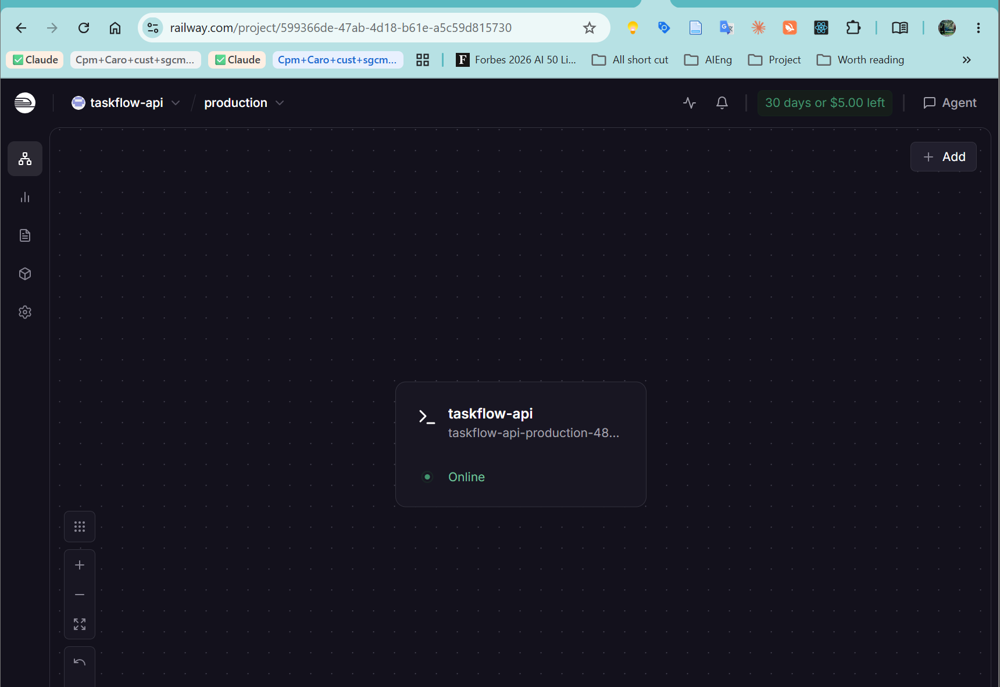
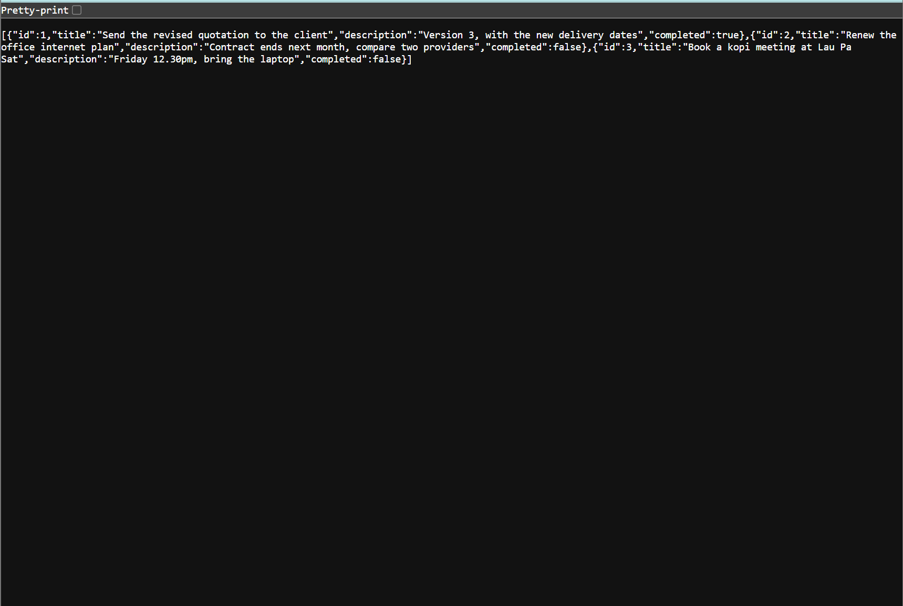

# TaskFlow API

Task-management REST API built with Spring Boot for the NTU AI Engineering course.
Module 3 built the API (this repo); **Module 4 deploys it** with Docker, GitHub Actions and Railway.

## Module 4 - End of Module Assignment

### Live application URL

TaskFlow API deployed on Railway (`/` is a small web page, `/api/tasks` is the JSON API):

```
https://taskflow-api-production-489b.up.railway.app/api/tasks
```

Backup demo of the same API on my own domain (UGREEN NAS + Cloudflare Tunnel):

```
https://artificialintelligence.sg/taskflow/api/tasks
```

### Screenshot: Railway dashboard



### Screenshot: Live application



### Errors and failures

```
None
```

What changed from the Module 3 code so it could be deployed:

- `server.port=${PORT:8080}` so the app listens on the port Railway injects.
- `OPENAI_API_KEY` now has a `not-set` fallback, so the app starts without a key and only
  `/api/tasks/summary` is disabled until a key is added as a Railway variable.
- `railway.json` tells Railway to build from the existing `Dockerfile` and health-check `/api/tasks`.
- Railway runs with `SPRING_PROFILES_ACTIVE=demo`, so the in-memory board starts with three sample
  tasks and resets every hour (the store is a HashMap and empties on every restart anyway).
- `static/index.html` is a one-page UI that calls the API, so the root URL shows something useful.
- `docker-compose.yml` for a one-command local run.

### Stretch goal (optional)

```
Stretch goal: CI pipeline (GitHub Actions) that builds, tests and publishes a Docker image to Docker Hub
Links: https://github.com/koh-ralph/module3-taskflow-api/actions
       https://hub.docker.com/r/mrpythonsg/taskflow-api/tags
       https://artificialintelligence.sg/taskflow/  (frontend demo on my own domain)
Notes: .github/workflows/ci.yml runs three jobs on every push to main: build (mvn package, uploads the jar),
       test (mvn test, uploads surefire reports) and publish (docker/build-push-action pushes
       mrpythonsg/taskflow-api:latest and :<git sha>). The publish job needs the repo secrets
       DOCKER_USERNAME and DOCKER_TOKEN; it skips itself cleanly if they are missing.
```

---

## Module 3 - the API itself

A small task-management backend built with Spring Boot for the NTU AI Engineering Module 3 assignment.

## What this is, in plain English

TaskFlow is the "back end" of a to-do list: a program that runs on a server and
keeps a list of tasks. It has no screens of its own. Other programs (Postman,
a web page, a phone app) talk to it over the web to add a task, read the list,
change a task, delete it, or mark it as done. There is one extra feature: it can
send the whole list to an AI and get back a two or three sentence summary of
what is finished and what is still pending.

You can try it live at <https://artificialintelligence.sg/taskflow/>.

## Stack

- Java 21, Maven, Spring Boot
- Spring Web, Lombok, Spring Boot DevTools
- Spring AI (OpenAI) for the optional summary endpoint (Task 6)

## Project structure

```
src/main/java/sg/edu/ntu/taskflowapi/
  controller/TaskController.java   REST endpoints
  service/TaskService.java         business logic
  repository/TaskRepository.java   in-memory store (HashMap + id counter)
  model/Task.java                  plain POJO (Lombok)
```

## Run

With Docker (no Java needed): `docker compose up --build`, then open <http://localhost:8080>.

With Maven, requires JDK 21.

The app reads the OpenAI key from the `OPENAI_API_KEY` environment variable
(`application.properties` has `spring.ai.openai.api-key=${OPENAI_API_KEY}`).
The real key is never stored in the project. Set the variable before starting:

```bash
export OPENAI_API_KEY=your-key-here   # bash / Git Bash
```

Then:

```bash
mvn spring-boot:run
```

The server starts on <http://localhost:8080>. If that port is already in use
on your machine, pick another one:

```bash
mvn spring-boot:run -Dspring-boot.run.arguments=--server.port=8081
```

If you only want to test Tasks 1 to 5, set `OPENAI_API_KEY` to any dummy value
such as `x`; the app still starts and only `/api/tasks/summary` will fail.

### Using OpenRouter instead of OpenAI (optional)

OpenRouter speaks the same API as OpenAI and offers free models, so the summary
endpoint can run at no cost. A Spring profile switches the client over without
any code change:

```bash
export OPENAI_API_KEY=sk-or-v1-...          # your OpenRouter key
export SPRING_PROFILES_ACTIVE=openrouter
mvn spring-boot:run
```

The profile file `src/main/resources/application-openrouter.properties` sets the
OpenRouter address and the `openrouter/free` model. Without the profile the app
talks to OpenAI directly, as the assignment describes.

### Demo profile and Docker (public showcase, not part of the assignment)

The API runs live at <https://artificialintelligence.sg/taskflow/>. For that,
`SPRING_PROFILES_ACTIVE=openrouter,demo` adds two guard rails: a 30-task cap
(`DemoLimitFilter`) and an hourly reset with sample tasks (`DemoResetService`).
The `Dockerfile` builds the container used there:

```bash
docker build -t taskflow-api .
docker run -p 8080:8080 -e OPENAI_API_KEY -e SPRING_PROFILES_ACTIVE=openrouter,demo taskflow-api
```

## Endpoints

| Method | Path                       | What it does            | Status |
|--------|----------------------------|-------------------------|--------|
| GET    | /api/tasks                 | Get all tasks           | 200    |
| GET    | /api/tasks/{id}            | Get one task by id      | 200    |
| POST   | /api/tasks                 | Create a new task       | 201    |
| PUT    | /api/tasks/{id}            | Update an existing task | 200    |
| DELETE | /api/tasks/{id}            | Delete a task           | 200    |
| PUT    | /api/tasks/{id}/complete   | Mark a task as complete | 200    |
| GET    | /api/tasks/summary         | AI summary (Task 6)     | 200    |

Unknown ids return 404.

Example request body for POST and PUT:

```json
{
  "title": "Finish Module 3 assignment",
  "description": "Build the TaskFlow API and push to GitHub",
  "completed": false
}
```

## Testing with Postman

Import `postman/TaskFlow.postman_collection.json`. It has one request per
endpoint, in a sensible order: create a few tasks first, then get, update,
complete, delete and summary.
